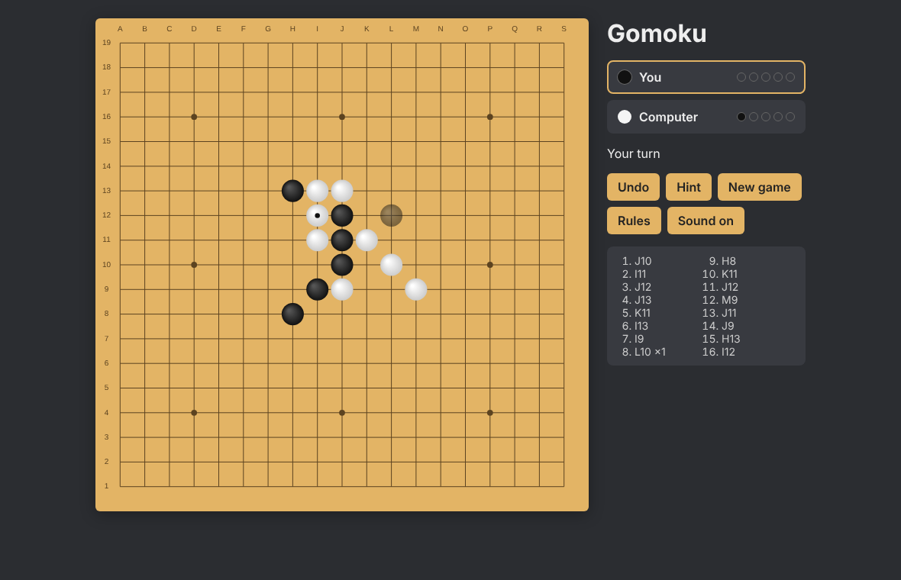

# gomoku-ai

**Play it here: https://gomoku-ai-b6yl.onrender.com**

Gomoku with the Pente rules (captures), playable in the browser against the computer or with a friend on the same screen.

## Rules

You win by lining up 5 stones, or by capturing 5 pairs. To capture, put your stones on both sides of exactly 2 enemy stones.

A five only wins if the other player can't break it by capturing a pair out of it. If he can, he has to do it right away. You also can't make two free threes with one move (3 stones that become an unstoppable four), unless that move captures something.

There are also the Pro and Long pro openings: the first stone goes in the middle, and black's second stone has to be at least 3 (or 4) cells away from it.

## The computer

It's a minimax with alpha-beta pruning (`js/ai.js`). To score a board, it looks at every group of 5 cells in a row: if only one player has stones in it, it's a possible five for him, and the more stones the better. Captures count too.

It only tries the most promising moves (next to other stones, sorted by a quick guess), and it searches deeper and deeper until half a second is used, usually 4 or 5 moves ahead. It runs in a Web Worker so the page doesn't freeze while it thinks.

## Code

Plain HTML, CSS and JavaScript, no framework and no build step.

- `js/rules.js` the game rules, no html in there
- `js/ai.js` the computer
- `js/worker.js` runs the computer in the background
- `js/board.js` draws the board on a canvas
- `js/main.js` everything else on the page

To run it, serve the folder with any static server, for example `python3 -m http.server`, then open http://localhost:8000. Opening `index.html` directly doesn't work because of the modules and the worker.

The tests use the Node test runner, no install needed: `npm test`
